# misc-crypto-mysteries
A place for a random assortment of crypto mysteries and curiosities (solved and unsolved).

<table>
<tr>
<td align="center" valign="top" width="25%">
<a href="https://doranchak.github.io/misc-crypto-mysteries/1901-theology-book-note">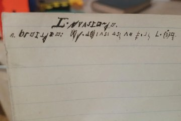</a> 
<a href="https://doranchak.github.io/misc-crypto-mysteries/1901-theology-book-note">1901 enciphered note in theology book</a>
</td>
<td align="center" valign="top" width="25%">
<a href="https://doranchak.github.io/misc-crypto-mysteries/artfight-odd-cipher">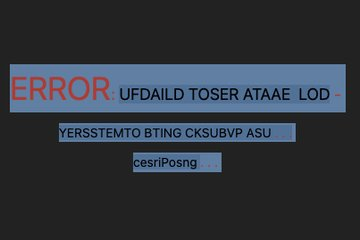</a> 
<a href="https://doranchak.github.io/misc-crypto-mysteries/artfight-odd-cipher">Artfight profile - odd cipher</a>
</td>
<td align="center" valign="top" width="25%">
<a href="https://doranchak.github.io/misc-crypto-mysteries/base-64-and-caesar-cipher">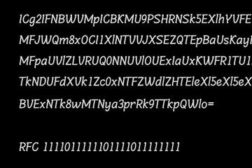</a> 
<a href="https://doranchak.github.io/misc-crypto-mysteries/base-64-and-caesar-cipher">Base-64 and Caesar cipher</a>
</td>
<td align="center" valign="top" width="25%">
<a href="https://doranchak.github.io/misc-crypto-mysteries/friend-two-ciphers-base64-caesar">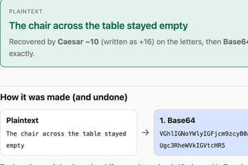</a> 
<a href="https://doranchak.github.io/misc-crypto-mysteries/friend-two-ciphers-base64-caesar">Base-64 and Caesar cipher 2</a>
</td>
</tr>
<tr>
<td align="center" valign="top" width="25%">
<a href="https://doranchak.github.io/misc-crypto-mysteries/bulgarian-treasure-hunt-cipher">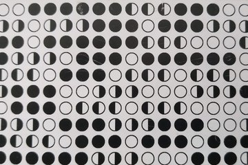</a> 
<a href="https://doranchak.github.io/misc-crypto-mysteries/bulgarian-treasure-hunt-cipher">Bulgarian treasure hunt</a>
</td>
<td align="center" valign="top" width="25%">
<a href="https://doranchak.github.io/misc-crypto-mysteries/spanish-class-checkerboard-cipher">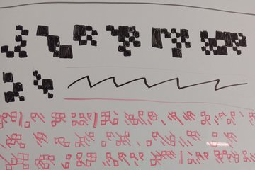</a> 
<a href="https://doranchak.github.io/misc-crypto-mysteries/spanish-class-checkerboard-cipher">Base3 code from a Spanish class</a>
</td>
<td align="center" valign="top" width="25%">
<a href="https://doranchak.github.io/misc-crypto-mysteries/cipher-leads-to-an-image">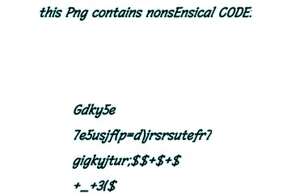</a> 
<a href="https://doranchak.github.io/misc-crypto-mysteries/cipher-leads-to-an-image">Cipher leads to an image</a>
</td>
<td align="center" valign="top" width="25%">
<a href="https://doranchak.github.io/misc-crypto-mysteries/disturbed-student-enciphered-journal">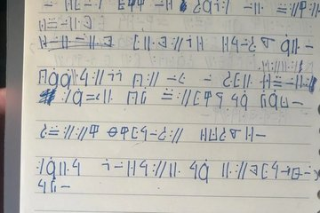</a> 
<a href="https://doranchak.github.io/misc-crypto-mysteries/disturbed-student-enciphered-journal">Disturbed student's enciphered journal</a>
</td>
</tr>
<tr>
<td align="center" valign="top" width="25%">
<a href="https://doranchak.github.io/misc-crypto-mysteries/oliver-twist-thrift-store">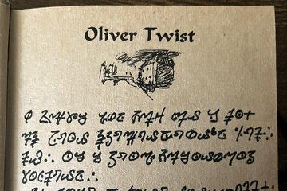</a> 
<a href="https://doranchak.github.io/misc-crypto-mysteries/oliver-twist-thrift-store">Enciphered diary in thrift store book</a>
</td>
<td align="center" valign="top" width="25%">
<a href="https://doranchak.github.io/misc-crypto-mysteries/gareth-penn-crypto-curiosities">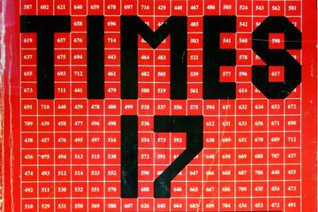</a> 
<a href="https://doranchak.github.io/misc-crypto-mysteries/gareth-penn-crypto-curiosities">Gareth Penn's crypto curiosities</a>
</td>
<td align="center" valign="top" width="25%">
<a href="https://doranchak.github.io/misc-crypto-mysteries/giokku-sci-fi-story-cipher">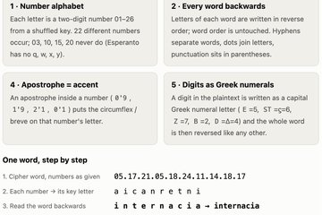</a> 
<a href="https://doranchak.github.io/misc-crypto-mysteries/giokku-sci-fi-story-cipher">Giokku's sci fi story cipher</a>
</td>
<td align="center" valign="top" width="25%">
<a href="https://doranchak.github.io/misc-crypto-mysteries/humancalledchris-cipher">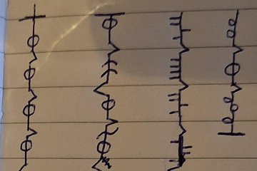</a> 
<a href="https://doranchak.github.io/misc-crypto-mysteries/humancalledchris-cipher">HumanCalledChris's stem-script cipher</a>
</td>
</tr>
<tr>
<td align="center" valign="top" width="25%">
<a href="https://doranchak.github.io/misc-crypto-mysteries/gods-can-see-monitor-cipher">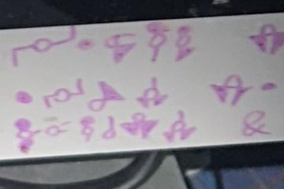</a> 
<a href="https://doranchak.github.io/misc-crypto-mysteries/gods-can-see-monitor-cipher">Marker code on a monitor bezel</a>
</td>
<td align="center" valign="top" width="25%">
<a href="https://doranchak.github.io/misc-crypto-mysteries/mock-trial-cipher">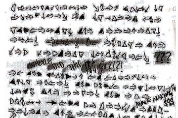</a> 
<a href="https://doranchak.github.io/misc-crypto-mysteries/mock-trial-cipher">Mock trial cipher</a>
</td>
<td align="center" valign="top" width="25%">
<a href="https://doranchak.github.io/misc-crypto-mysteries/juniorappearance8347-pdf-password-puzzle">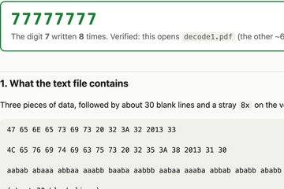</a> 
<a href="https://doranchak.github.io/misc-crypto-mysteries/juniorappearance8347-pdf-password-puzzle">PDF password puzzle</a>
</td>
<td align="center" valign="top" width="25%">
<a href="https://doranchak.github.io/misc-crypto-mysteries/pigpen-notebook-cipher">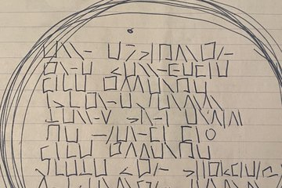</a> 
<a href="https://doranchak.github.io/misc-crypto-mysteries/pigpen-notebook-cipher">Pigpen notebook cipher</a>
</td>
</tr>
<tr>
<td align="center" valign="top" width="25%">
<a href="https://doranchak.github.io/misc-crypto-mysteries/caesar-shift-per-word">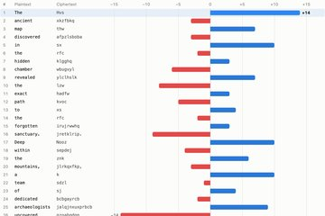</a> 
<a href="https://doranchak.github.io/misc-crypto-mysteries/caesar-shift-per-word">Rudranshkh's Caesar-shift-per-word cipher</a>
</td>
<td align="center" valign="top" width="25%">
<a href="https://doranchak.github.io/misc-crypto-mysteries/solid-camp6739-code">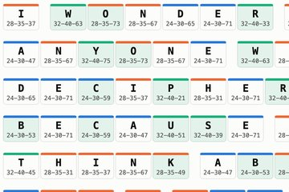</a> 
<a href="https://doranchak.github.io/misc-crypto-mysteries/solid-camp6739-code">Solid-Camp6739's code of triples</a>
</td>
<td align="center" valign="top" width="25%">
<a href="https://doranchak.github.io/misc-crypto-mysteries/tbstewa-custom-cipher/report.html">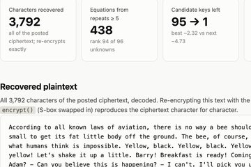</a> 
<a href="https://doranchak.github.io/misc-crypto-mysteries/tbstewa-custom-cipher/report.html">tbstewa's custom cipher</a>
</td>
<td align="center" valign="top" width="25%">
<a href="https://doranchak.github.io/misc-crypto-mysteries/tech-tools-substitution-cipher">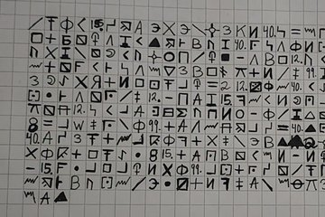</a> 
<a href="https://doranchak.github.io/misc-crypto-mysteries/tech-tools-substitution-cipher">Tech tools substitution cipher</a>
</td>
</tr>
<tr>
<td align="center" valign="top" width="25%">
<a href="https://doranchak.github.io/misc-crypto-mysteries/the-lost-spiral">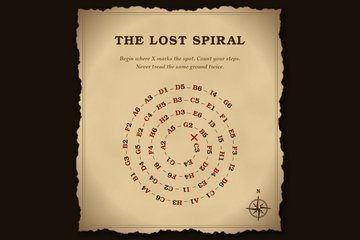</a> 
<a href="https://doranchak.github.io/misc-crypto-mysteries/the-lost-spiral">The Lost Spiral</a>
</td>
<td align="center" valign="top" width="25%">
<a href="https://doranchak.github.io/misc-crypto-mysteries/tifinagh-youtube-post">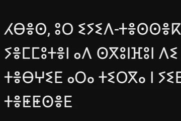</a> 
<a href="https://doranchak.github.io/misc-crypto-mysteries/tifinagh-youtube-post">Tifinagh YouTube post (Kabyle)</a>
</td>
<td align="center" valign="top" width="25%">
<a href="https://doranchak.github.io/misc-crypto-mysteries/tiktok-comment">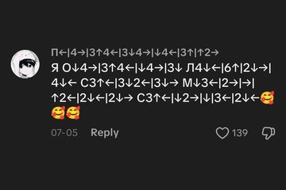</a> 
<a href="https://doranchak.github.io/misc-crypto-mysteries/tiktok-comment">TikTok comment (Russian)</a>
</td>
<td align="center" valign="top" width="25%">
<a href="https://doranchak.github.io/misc-crypto-mysteries/vowel-cipher">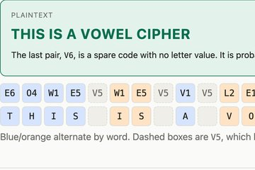</a> 
<a href="https://doranchak.github.io/misc-crypto-mysteries/vowel-cipher">Vowel cipher</a>
</td>
</tr>
<tr>
<td align="center" valign="top" width="25%">
<a href="https://doranchak.github.io/misc-crypto-mysteries/class-chalkboard-code">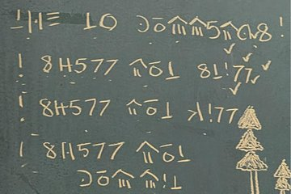</a> 
<a href="https://doranchak.github.io/misc-crypto-mysteries/class-chalkboard-code">Weird code on class chalkboard</a>
</td>
<td align="center" valign="top" width="25%">
<a href="https://doranchak.github.io/misc-crypto-mysteries/weird-message-from-a-strange-guy">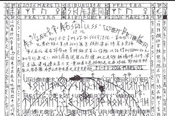</a> 
<a href="https://doranchak.github.io/misc-crypto-mysteries/weird-message-from-a-strange-guy">Weird message from a strange guy</a>
</td>
<td align="center" valign="top" width="25%">
<a href="https://doranchak.github.io/misc-crypto-mysteries/xmr-monero-wallet">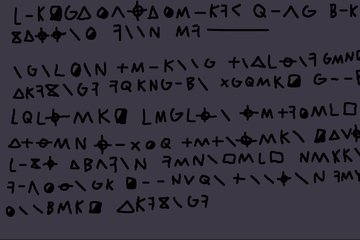</a> 
<a href="https://doranchak.github.io/misc-crypto-mysteries/xmr-monero-wallet">XMR Monero wallet cipher</a>
</td>
<td align="center" valign="top" width="25%">
<a href="https://doranchak.github.io/misc-crypto-mysteries/z340-inspired-art-codes">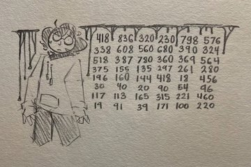</a> 
<a href="https://doranchak.github.io/misc-crypto-mysteries/z340-inspired-art-codes">Z340-inspired art codes</a>
</td>
</tr>
<tr>
<td align="center" valign="top" width="25%">
<a href="https://doranchak.github.io/misc-crypto-mysteries/zodiac-hat">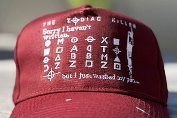</a> 
<a href="https://doranchak.github.io/misc-crypto-mysteries/zodiac-hat">Zodiac hat cipher</a>
</td>
</tr>
</table>
